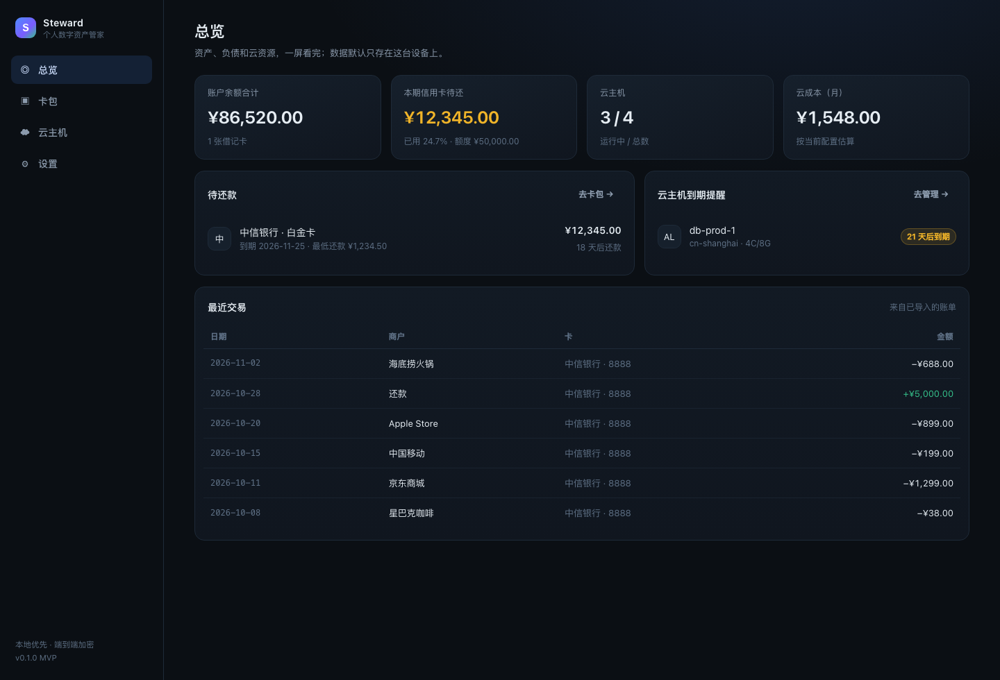
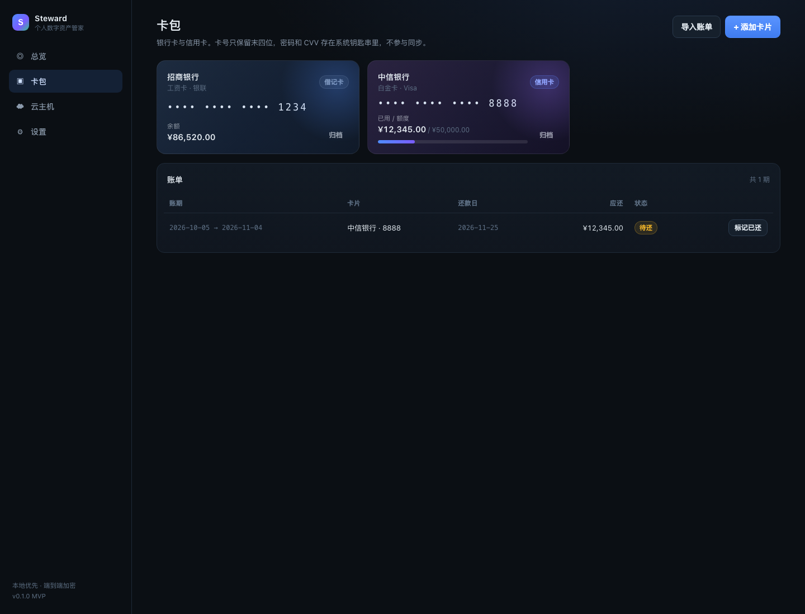
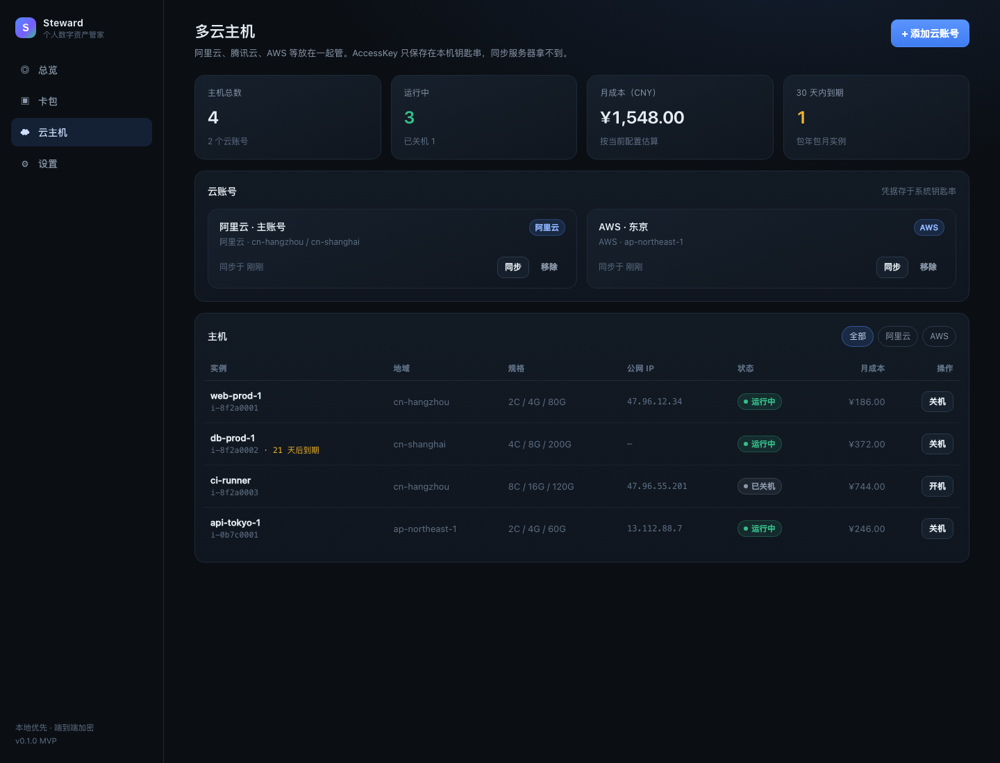
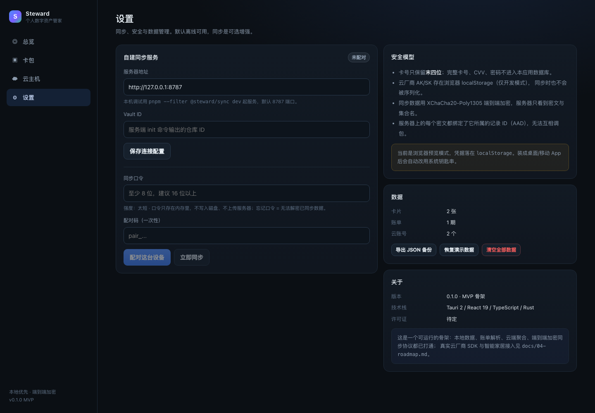
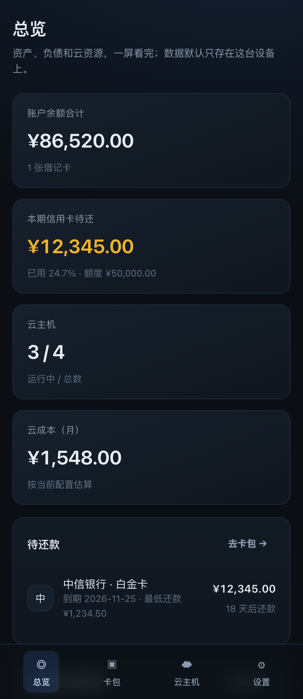

# Steward · 个人数字资产管家

把散落在银行 App、云厂商控制台、智能家居平台里的个人数字资产收拢到一处：
**银行卡 / 信用卡账单、多云主机、智能家居**，一个界面管理。

一套代码跑 **macOS / Windows / Linux / iOS / Android**（Tauri 2 + React 19 + Rust），
默认**本地优先**，同步是可选的自建服务，服务器只存密文。

```
┌─────────────────────────────────────────────────────────────┐
│  Tauri 2 壳（桌面 / iOS / Android）                          │
│  ├─ React 19 前端：总览 / 卡包 / 云主机 / 设置                │
│  └─ Rust：系统钥匙串读写、后续的原生 SDK 与文件能力            │
├─────────────────────────────────────────────────────────────┤
│  @steward/core：领域模型 · 金额 · 账单解析 · 加密 · 同步协议   │
├─────────────────────────────────────────────────────────────┤
│  @steward/sync（可选，自托管）：Fastify + SQLite，只存密文     │
└─────────────────────────────────────────────────────────────┘
```

## 当前状态：v0.1 MVP 骨架（可运行）

| 能力 | 状态 |
| --- | --- |
| 总览聚合（资产、待还、云成本、到期提醒） | ✅ 可用 |
| 卡包：增删卡、额度/余额、账单列表、标记已还 | ✅ 可用 |
| 银行账单 CSV 导入（多格式、容错、逐行报错） | ✅ 可用，52 个单测覆盖 |
| 多云主机列表 / 开关机 / 成本汇总 | ✅ 界面与数据流已通，**适配器为 Mock** |
| 端到端加密同步（自建服务器、设备配对、LWW 合并） | ✅ 协议与服务端已完成并测试 |
| 真实云厂商 SDK（阿里云/腾讯云/AWS） | ⛔ 未接入，见路线图 |
| 智能家居（Home Assistant / Matter） | ⛔ 数据模型已预留，未接入 |

> Mock 适配器会生成稳定的假实例数据，用于打通界面与数据流。
> 它**不会**调用任何云厂商 API，也不会产生费用。

## 界面预览

| 总览 | 卡包 |
| --- | --- |
|  |  |

| 多云主机 | 设置 |
| --- | --- |
|  |  |

<p align="center">
  
</p>

## 快速开始

前置：Node.js ≥ 22、pnpm ≥ 10。桌面端另需 Rust 工具链（`rustup`），
iOS/Android 还需 Xcode / Android Studio。

```bash
pnpm install
pnpm --filter @steward/core build     # 先构建领域层

# 1) 浏览器里预览界面（最快）
pnpm dev
#    → http://localhost:5173

# 2) 桌面 App（需要 Rust）
pnpm tauri dev

# 3) 自建同步服务（可选）
pnpm --filter @steward/sync dev        # http://127.0.0.1:8787
node services/sync/dist/main.js init   # 建仓库，输出 Vault ID + 一次性配对码
```

首次启动会载入一份演示数据（2 张卡、1 期账单、2 个云账号、4 台主机），
在「设置 → 恢复演示数据 / 清空全部数据」里可以随时重来。

## 常用命令

```bash
pnpm test          # 全部单测（core 52 个 + sync 21 个）
pnpm typecheck     # 全仓类型检查
pnpm build         # 构建 core + 前端产物
pnpm dev           # 前端开发服务器
pnpm dev:sync      # 同步服务（watch 模式）
pnpm tauri         # 透传 Tauri CLI（dev / build / android / ios）
```

## 目录结构

```
apps/app/                 Tauri 2 应用（React 前端 + src-tauri Rust 壳）
  src/pages/              总览 / 卡包 / 云主机 / 设置
  src/data/               本地状态、凭据存储、同步编排
  src-tauri/              原生壳：钥匙串命令、打包配置、各平台图标
packages/core/            与平台无关的领域层（零 DOM、零 SDK 依赖）
  src/bills/              账单 CSV 解析（表头识别、日期/金额容错）
  src/cloud/              多云适配器接口 + Mock 实现 + 聚合
  src/crypto/             XChaCha20-Poly1305、scrypt 密钥派生
  src/sync/               记录封包、LWW 合并、同步客户端
services/sync/            自托管同步服务（Fastify + node:sqlite）
docs/                     产品、架构、安全、路线图
```

## 设计上的几个关键决定

1. **金额只用整数（分）**，跨币种不做隐式换算 —— 见 `packages/core/src/money.ts`。
2. **两个密钥，互不混用**：本地保险箱密钥在系统钥匙串，同步密钥由口令派生、只在内存里。
3. **服务器是「加密邮筒」**：只存密文 + 集合名 + 版本号，管理员看不到卡号和主机信息。
4. **账单导入永不整体失败**：逐行返回失败原因，用户能手工补录。
5. **适配器模式**：云厂商差异被 `CloudProviderAdapter` 吸收，接真实 SDK 时不动 UI。

细节见 [docs/02-architecture.md](docs/02-architecture.md) 与 [docs/03-security.md](docs/03-security.md)。

## 已知限制（v0.1）

- 云厂商适配器只有 Mock；真实接入需要处理签名、地域、分页与限流。
- 同步是整条记录的 LWW，并发修改会覆盖，落败版本仅计数，尚未做可回滚的冲突快照。
- 删除暂不支持墓碑同步（归档替代删除）。
- `node:sqlite` 仍是实验性 API，升级 Node 大版本时需回归。
- 桌面端未在本仓库 CI 中编译（当前环境无 Rust），首次 `pnpm tauri dev` 会下载依赖。

## 许可证

待定（建议 AGPL-3.0 或 BUSL，视商业化方式选择）。
